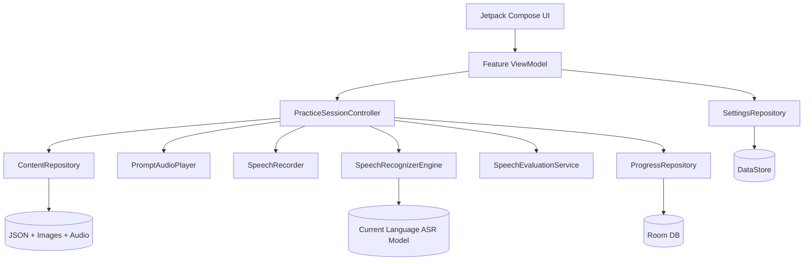
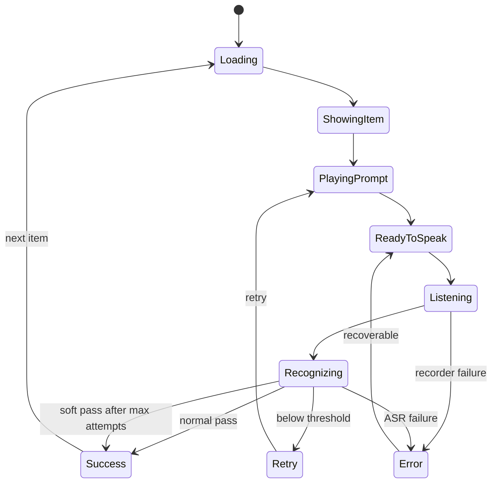
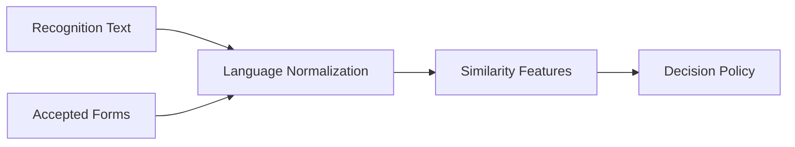

# Kids Language Companion 技术开发设计书

> Version: 1.1 Draft Baseline  
> Scope: Android V1  
> Related: `01_Product_Requirements.md`

---

# 1. 技术目标

本设计以以下目标为优先级：

1. Android 10 真机稳定运行。
2. 核心功能离线可用。
3. 不依赖识字能力的低延迟交互。
4. 儿童语音判定“足够好”而非考试级精确。
5. 内容数据驱动。
6. ASR 引擎可替换。
7. 架构不过度设计，V1 保持小而可维护。

---

# 2. 技术栈

| Layer | Technology |
|---|---|
| Language | Kotlin |
| UI | Jetpack Compose |
| Min SDK | API 29 / Android 10 |
| Target SDK | 实施时采用最新稳定、且不破坏 Android 10 兼容性的 SDK |
| State | ViewModel + StateFlow |
| DI | V1 可使用手工构造；规模扩大后再考虑 Hilt/Koin |
| Local Settings | DataStore Preferences |
| Progress DB | Room |
| Audio Playback | Media3 / ExoPlayer for prompt audio；SoundPool for short effects |
| Recording | AudioRecord |
| Offline ASR | Vosk V1 implementation |
| Serialization | kotlinx.serialization |
| Image | Compose resources / local assets；必要时 Coil |
| Testing | JUnit + Robolectric/Instrumented tests + Compose UI tests |

## 2.1 为什么 V1 不强制多模块

应用规模很小，多模块会增加 Gradle 和 Agent 修改成本。

建议先采用单 `app` module + 清晰 package 边界：

```text
com.example.kidslanguage/
├─ app/
├─ core/
│  ├─ audio/
│  ├─ asr/
│  ├─ content/
│  ├─ model/
│  ├─ persistence/
│  ├─ mascot/
│  └─ scoring/
├─ feature/
│  ├─ home/
│  ├─ category/
│  ├─ repeat/
│  ├─ choose/
│  └─ parent/
└─ ui/
```

当 Build 时间、团队边界或复用需求出现后，再拆 Gradle modules。

---

# 3. 总体架构



---


# 3.1 吉祥物子系统（Mascot Subsystem）

V1 引入轻量卡通角色子系统，不需要复杂骨骼动画。推荐实现：

- 以透明背景 PNG / WebP 静态姿势资源为基础；
- 运行时通过 Compose Animation 做轻量动效（缩放、上下浮动、左右晃动、淡入淡出）；
- 成功反馈叠加星星、闪光、彩带等低成本效果；
- 失败反馈仅使用轻微下沉、耳朵下垂或蓝色小汗滴等温和视觉元素。

建议接口：

```kotlin
interface MascotAssetRepository {
    fun getPose(state: MascotState): MascotPoseAsset
}

enum class MascotState {
    Idle,
    Listen,
    Speak,
    Great,
    TryAgain,
    Praise
}
```

建议资源目录：

```text
assets/mascot/
├─ bunny_idle.webp
├─ bunny_listen.webp
├─ bunny_speak.webp
├─ bunny_great.webp
├─ bunny_try_again.webp
├─ bunny_praise.webp
└─ fx/
   ├─ stars_01.webp
   └─ spark_01.webp
```

当前文档包附带概念素材：`assets/mascot/bunny_mascot_expression_sheet.png`。

# 4. 核心领域模型

## 4.1 LanguageCode

```kotlin
enum class LanguageCode {
    JA_JP,
    ZH_CN,
    EN_US
}
```

禁止在业务逻辑中散落裸字符串。

## 4.2 PracticeMode

```kotlin
enum class PracticeMode {
    LISTEN_REPEAT,
    LISTEN_CHOOSE
}
```

## 4.3 ContentItem

建议 Kotlin Model：

```kotlin
@Serializable
data class ContentItem(
    val id: String,
    val language: LanguageCode,
    val categoryId: String,
    val targetText: String,
    val displayText: String? = null,
    val reading: String? = null,
    val acceptedTranscripts: List<String> = emptyList(),
    val keywords: List<String> = emptyList(),
    val promptAudio: String,
    val image: String,
    val modes: Set<PracticeMode>,
    val difficulty: Int = 1,
    val tags: List<String> = emptyList()
)
```

### 字段说明

| Field | Meaning |
|---|---|
| `id` | 全局稳定 ID，不随显示文本变化 |
| `targetText` | 标准目标表达 |
| `displayText` | 可选儿童/家长显示文本 |
| `reading` | 日语假名或中文拼音等辅助数据 |
| `acceptedTranscripts` | 可接受识别结果别名 |
| `keywords` | 长句允许关键成分判定时使用 |
| `promptAudio` | 标准音频资源路径 |
| `image` | 主图资源路径 |
| `modes` | 支持的题型 |

---

# 5. 内容文件设计

## 5.1 建议目录

```text
content/
├─ manifest.json
├─ ja/
│  ├─ categories.json
│  ├─ kindergarten.json
│  ├─ audio/
│  └─ images/
├─ zh/
│  ├─ categories.json
│  ├─ daily.json
│  ├─ audio/
│  └─ images/
└─ en/
   ├─ categories.json
   ├─ daily.json
   ├─ audio/
   └─ images/
```

## 5.2 manifest.json

```json
{
  "schemaVersion": 1,
  "contentVersion": "2026.09.1",
  "languages": ["ja-JP", "zh-CN", "en-US"]
}
```

## 5.3 Item 示例

```json
{
  "id": "ja-play-001",
  "language": "ja-JP",
  "categoryId": "play",
  "targetText": "いっしょにあそぼう",
  "displayText": "いっしょに あそぼう",
  "reading": "いっしょにあそぼう",
  "acceptedTranscripts": [
    "いっしょにあそぼう",
    "一緒に遊ぼう",
    "いっしょにあそぼ"
  ],
  "keywords": ["いっしょ", "あそぼう"],
  "promptAudio": "ja/audio/play_001.ogg",
  "image": "ja/images/play_together.webp",
  "modes": ["LISTEN_REPEAT", "LISTEN_CHOOSE"],
  "difficulty": 1,
  "tags": ["kindergarten", "social"]
}
```

## 5.4 内容校验工具

构建时应提供内容校验脚本，至少检查：

- ID 唯一；
- JSON Schema 合法；
- 音频文件存在；
- 图片存在；
- `targetText` 非空；
- 至少一种 mode；
- Category 存在；
- `acceptedTranscripts` 不含重复；
- 文件名只使用可移植字符。

CI 中内容校验失败应阻止 Release Build。

---

# 6. Practice Session 状态机

Listen & Repeat 必须按显式状态机实现，禁止由多个独立 Boolean 拼凑。

```kotlin
sealed interface RepeatState {
    data object Loading : RepeatState
    data object ShowingItem : RepeatState
    data object PlayingPrompt : RepeatState
    data object ReadyToSpeak : RepeatState
    data object Listening : RepeatState
    data object Recognizing : RepeatState
    data class Success(val assisted: Boolean) : RepeatState
    data class Retry(val attempt: Int) : RepeatState
    data class Error(val recoverable: Boolean) : RepeatState
}
```

## 6.1 状态转换



---

# 7. 音频播放设计

## 7.1 标准发音

V1 使用预录音频，不依赖 TTS。

优点：

- 发音稳定；
- 无模型加载；
- 离线；
- 可人为控制儿童友好的语速和语气；
- 避免不同 Android TTS 引擎差异。

建议格式：

- `.ogg` 或 `.m4a`
- Mono
- 44.1 kHz 或 48 kHz 源文件均可
- 发布前做响度归一化

## 7.2 Playback Policy

标准语音播放时：

- 不进行 ASR；
- 录音开始前等待播放完成；
- 成功音效不能和下一题 Prompt 重叠。

Sound effects 与 Prompt 使用独立 Channel / Player。

---

# 8. 录音设计

## 8.1 AudioRecord 参数

Vosk 常用输入目标：

```text
Sample rate: 16000 Hz
Channels: MONO
Encoding: PCM 16-bit
```

具体值以实际 Vosk Android 版本要求为准。

## 8.2 Recording Start

支持两种策略：

### Auto Mode

Prompt 播放结束后：

1. 300～500 ms 准备间隔；
2. 自动开始监听；
3. UI 出现明显麦克风动画。

### Manual Mode

儿童点击大麦克风按钮开始，点击或说完自动停止。

## 8.3 End-of-Speech

V1 不要求复杂神经 VAD。

建议：

- 最低录音时长，例如 400 ms；
- 检测到语音后，持续静音约 700～1000 ms 认为说完；
- 最大录音时长约 6～8 s；
- 从未检测到有效声音则返回 `NO_SPEECH`，不得记作 pronunciation failure。

参数必须可配置，不能散落 magic number。

---

# 9. ASR 抽象

## 9.1 Interface

```kotlin
interface SpeechRecognizerEngine {
    suspend fun load(language: LanguageCode): Result<Unit>
    suspend fun unload()
    suspend fun recognize(
        audio: ShortArray,
        sampleRate: Int,
        hints: List<String> = emptyList()
    ): RecognitionResult
}
```

```kotlin
data class RecognitionResult(
    val text: String,
    val alternatives: List<String> = emptyList(),
    val confidence: Float? = null,
    val engine: String,
    val latencyMs: Long
)
```

## 9.2 V1：VoskSpeechRecognizerEngine

V1 优先采用轻量 Vosk 模型：

- Japanese small model
- Chinese small model
- English small model

原则：

- 仅加载当前语言；
- 切换语言前卸载旧模型；
- Model loading 不在 UI Thread；
- 如果具体版本支持 grammar / constrained vocabulary，则利用当前 Item 的目标与 accepted forms 做 phrase bias；
- 若该 API 在选定版本不可用，仍保持上层 `hints` 接口，不改变业务层。

## 9.3 ModelManager

职责：

```text
ensureInstalled(language)
load(language)
unloadCurrent()
getVersion(language)
getStatus(language)
```

模型可以随 APK assets 交付并首次使用时解压到 app private storage。

不得同时把 3 个模型全部驻留内存。

---

# 10. 语音判定设计

## 10.1 目标

不是判断儿童是否达到语言考试标准，而是判断：

> “这次尝试是否足够接近当前目标，值得给出成功反馈？”

因此评分策略优先降低 False Negative。

## 10.2 Pipeline



## 10.3 Normalization Common

所有语言：

- Unicode normalize；
- trim；
- 去无意义标点；
- 统一空格；
- 可选去 filler token；
- 大小写标准化（英语）。

## 10.4 English

特征：

- token exact match；
- normalized Levenshtein similarity；
- WER；
- keyword coverage。

例如：

```text
Target: I want some water
ASR:    I want water
```

对启蒙儿童应允许通过或接近通过。

## 10.5 Chinese

V1：

- 简繁不作为核心场景，但可做字符标准化；
- 字符级 edit similarity；
- accepted transcripts；
- keyword coverage。

后续可增加拼音层比较，但不作为 V1 必需。

## 10.6 Japanese

日语必须处理 ASR 可能输出不同书写形式的问题，例如：

```text
いっしょにあそぼう
一緒に遊ぼう
```

V1 设计要求：

1. Content 提供 `reading` 与 `acceptedTranscripts`；
2. 尽量使用 ASR phrase hints / grammar 限定候选；
3. `JapaneseNormalizer` 接口独立；
4. 若 PoC 证明仅 accepted forms 不足，再加入日语 tokenizer/reading conversion library。

不要在未验证前把大型日语 NLP 依赖写死进架构。

## 10.7 Evaluation Features

```kotlin
data class EvaluationFeatures(
    val exactAcceptedMatch: Boolean,
    val normalizedSimilarity: Float,
    val keywordCoverage: Float,
    val asrConfidence: Float?,
    val speechDurationMs: Long,
    val attempt: Int
)
```

## 10.8 初始 Decision Policy

阈值必须通过真实儿童测试校准；以下只是 V1 初值，不是语言学评分标准。

建议：

```text
if exactAcceptedMatch:
    PASS
else if normalizedSimilarity >= baseThreshold:
    PASS
else if keywordCoverage >= keywordThreshold && similarity >= relaxedThreshold:
    PASS
else:
    RETRY / SOFT_PASS according to attempt
```

初始参数建议：

```text
baseThreshold      = 0.72
relaxedThreshold   = 0.62
keywordThreshold   = 0.75
maxNormalAttempts  = 2
softPassAttempt    = 3
```

### 注意

这些数值必须集中在配置中，例如：

```kotlin
data class SpeechEvaluationConfig(...)
```

不得埋在 ViewModel。

## 10.9 Soft Pass

Attempt 3 仍未达到阈值时：

- 记录 `assistedPass = true`；
- 儿童仍得到积极结束反馈；
- 不显示错误百分比；
- 该 Item 后续可以提高复习权重。

---

# 11. Listen & Choose 设计

每个听力 Item 需要：

```kotlin
data class ChoiceQuestion(
    val promptItemId: String,
    val optionItemIds: List<String>,
    val correctItemId: String
)
```

V1 可以在运行时从同 Category 中生成 distractor。

规则：

- 不能用同一张图；
- 不要选择语义过于模糊的 distractor；
- 正确答案位置随机；
- 2～4 个选项由家长设置或 Lesson 配置决定。

---

# 12. Progress 数据库

## 12.1 Room Entity

```kotlin
@Entity(tableName = "item_progress")
data class ItemProgressEntity(
    @PrimaryKey val itemId: String,
    val totalAttempts: Int,
    val normalPasses: Int,
    val assistedPasses: Int,
    val chooseCorrect: Int,
    val chooseWrong: Int,
    val lastPracticedAt: Long
)
```

## 12.2 Session Entity

可选但建议：

```kotlin
@Entity(tableName = "practice_session")
data class PracticeSessionEntity(
    @PrimaryKey val sessionId: String,
    val language: String,
    val mode: String,
    val startedAt: Long,
    val endedAt: Long?,
    val itemCount: Int
)
```

不保存原始语音。

---

# 13. Settings

使用 DataStore 保存：

```text
defaultLanguage
showText
autoPlayPrompt
autoStartRecording
autoNext
sessionItemCount
soundEffectsEnabled
musicEnabled
parentModeLastCategory
```

设置修改立即生效或下一题生效，避免要求重启 App。

---

# 14. 权限

V1 必需权限：

```xml
<uses-permission android:name="android.permission.RECORD_AUDIO" />
```

原则：

- 第一次进入 Listen & Repeat 时再请求，不在启动首页立即请求；
- 拒绝后仍可使用 Listen & Choose；
- 不请求 Contacts、Location、Camera、Storage 等不必要权限。

如果所有内容都在 app private storage，不需要传统外部存储权限。

---

# 15. 资源安装与离线模型

## 15.1 App Package

V1 可以接受 APK 比普通 App 大，因为属于专用平板场景。

建议：

```text
APK / App Bundle
  ├─ application
  ├─ content json
  ├─ images
  ├─ prompt audio
  └─ compressed ASR models
```

## 15.2 First Use

语言第一次使用时：

```text
Check model installed
→ if no: unpack from assets
→ verify manifest / checksum
→ load model
→ enter lesson
```

解压过程必须：

- 显示进度；
- 可恢复；
- 不阻塞主线程；
- 解压完成后写 version marker。

---

# 16. UI 状态和 ViewModel 边界

ViewModel 不直接操作 Android AudioRecord / MediaPlayer。

推荐：

```text
RepeatViewModel
  └─ PracticeSessionController
       ├─ PromptAudioPlayer
       ├─ SpeechRecorder
       ├─ SpeechRecognizerEngine
       ├─ SpeechEvaluationService
       └─ ProgressRepository
```

这样可以在 Unit Test 中完全替换音频和 ASR。

---

# 17. 错误处理

## 17.1 错误分类

```kotlin
sealed interface AppError {
    data object MicrophonePermissionDenied
    data object RecorderUnavailable
    data object AsrModelMissing
    data object AsrLoadFailed
    data object RecognitionFailed
    data class ContentInvalid(val itemId: String)
    data class AssetMissing(val path: String)
}
```

## 17.2 Child Mode

不得显示：

```text
VoskRecognizerException: failed to initialize model
```

儿童界面只显示图形化恢复方式：

- 麦克风图标不可用；
- Speaker 重播；
- 返回；
- 进入听力模式。

详细错误只进本地日志 / Parent Diagnostics。

---

# 18. 日志与诊断

V1 应保留轻量本地日志：

```text
App startup
Content manifest load
Model install/load/unload
Audio recorder start/stop
ASR latency
Recognition text (可配置脱敏策略)
Evaluation decision
Fatal/recoverable error
```

默认不得记录原始 PCM。

生产环境建议日志轮转，避免无限增长。

家长诊断页可显示：

```text
App version
Content version
Device / Android version
Current language model
Model version
Last ASR error
Free storage
```

---

# 19. 性能预算

以下是工程目标，不是未经实测保证：

| 项目 | V1 Target |
|---|---:|
| Home 首屏 | 冷启动后尽快可操作；目标 < 3 s（模型不在启动时加载） |
| Lesson 切题 | < 300 ms 感知延迟 |
| Prompt playback start | < 150 ms after request |
| Recognition result | utterance end 后目标约 ≤ 1 s |
| Active ASR models | 1 |
| UI thread blocking | 禁止 > 100 ms 的模型/文件操作 |
| Child interaction FPS | 以 60 Hz 流畅为目标 |

ASR Model 首次解压不计入 Home 冷启动预算。

---

# 20. 测试策略

## 20.1 Unit Tests

必须覆盖：

- Content parser
- Content validation
- Normalizers
- Levenshtein / WER
- Evaluation policy
- Attempt → Soft Pass logic
- Session sequencing
- Progress aggregation

## 20.2 Golden ASR Evaluation Dataset

建立本地测试集：

```text
tests/audio/
├─ ja/
├─ zh/
└─ en/
```

包含：

- 成人标准音频；
- 儿童实际音频（得到家长明确许可时）；
- 背景噪声；
- 近似发音；
- 完全错误表达；
- 无语音。

每条测试样本必须定义期望：

```text
PASS
RETRY
NO_SPEECH
```

## 20.3 Compose UI Tests

至少覆盖：

- Home → Language → Category → Lesson
- Retry flow
- Soft Pass flow
- Listen & Choose correct/wrong
- Parent Mode entry
- Permission denied

## 20.4 真机测试

必须使用目标 Android 10 平板。

至少检查：

- 2560×1600 横屏布局；
- Speaker 音量；
- 麦克风拾音；
- ASR 内存；
- 连续 30 分钟练习；
- 前后台切换；
- 屏幕锁定恢复；
- 飞行模式；
- 低剩余存储；
- 重启后进度。

## 20.5 儿童可用性测试

成人通过所有自动化测试不能替代儿童实际观察。

重点记录：

```text
Does the child know when to speak?
Does the child find replay without help?
How often does recognition reject a reasonable attempt?
Does retry cause frustration?
Does the child understand image choices?
```

---

# 21. CI / Build

建议流水线：

```text
./gradlew lint
content-validator
unit tests
assembleDebug
```

阶段性再运行：

```text
instrumented tests
release build
APK smoke test on device
```

开发阶段不要求每次小改动都运行全量耗时 UI 测试；功能块完成后再进行对应回归。

---

# 22. PoC 阶段必须验证的技术风险

在大量制作内容前，先做 10～20 条句子的 ASR PoC。

## POC-ASR-001 儿童日语识别率

测试真实幼儿对：

- おはよう
- ありがとう
- いれて
- かして
- いっしょにあそぼう
- トイレにいきたい

等表达。

目标不是字字正确，而是能否支撑“成功 / 再试一次”的宽松判定。

## POC-ASR-002 环境噪声

测试：

- 家庭安静环境；
- 电视声；
- 成人说话；
- 平板扬声器回声。

## POC-ASR-003 模型切换

验证：

```text
JA loaded
→ unload
→ ZH loaded
→ unload
→ EN loaded
```

无内存持续增长。

## POC-ASR-004 Android 10 真机性能

测：

- load time
- recognition latency
- peak RSS
- crash / ANR

---

# 23. ASR 替换策略

如果 Vosk 实测不满足儿童语音要求，不改变 Feature 层。

只替换：

```text
SpeechRecognizerEngine
```

候选顺序：

1. sherpa-onnx
2. Whisper-family mobile implementation
3. Cloud pronunciation / ASR service（仅作为可选在线增强）

上层 `SpeechEvaluationService` 保留，因此引擎替换不影响课程和 UI。

---

# 24. 后续演进

## V1.1

- 内容包导入
- 家长录音 Prompt
- 自定义复习列表

## V1.2

新增：

```text
Picture → Speak
```

复用现有：

```text
SpeechRecorder
SpeechRecognizerEngine
SpeechEvaluationService
```

## V2

新增 `DialogueEngine`：

```text
Character: かして
Child: いいよ
Character animation: ありがとう！
```

仍应优先使用受控状态机，不直接放开开放域 LLM 对话。

---

# 25. Implementation Order

推荐实施顺序：

```text
Phase 0  Repo + Compose shell
Phase 1  Content schema + validator
Phase 2  Prompt audio + image lesson playback
Phase 3  Listen & Choose
Phase 4  AudioRecord + Vosk single-language PoC
Phase 5  SpeechEvaluationService
Phase 6  Full Listen & Repeat state machine
Phase 7  Multi-language model manager
Phase 8  Room progress + Parent settings
Phase 9  UX polish + animations
Phase 10 Real child calibration + threshold tuning
Phase 11 Release hardening
```

先验证 ASR，再制作大量内容，避免内容资产投入后才发现引擎不合适。


---

# 追加实现说明：角色状态映射

建议在练习状态机中加入 UI 层角色映射，而不是在业务层硬编码图片路径：

| Practice UI State | MascotState | 说明 |
|---|---|---|
| PageLoaded | Idle | 初始等待 |
| PromptPlaying | Listen | 系统播放示范时 |
| WaitingForSpeech | Speak | 鼓励孩子开口 |
| Recording | Speak | 保持说话动作，可增加麦克风脉冲 |
| Evaluating | Listen | 正在“认真听” |
| Passed | Great / Praise | 成功反馈 |
| Retry | TryAgain | 温和重试提示 |
| SoftPass | Praise | 多次失败后鼓励继续 |

资源优化建议：

- 首版可以只保留一张“表情姿势集”用于设计确认，开发落地时再拆分为单 pose 文件。
- 反馈音效长度建议 < 1.2 秒。
- 角色图片建议导出透明背景 WebP，单张控制在 100~300 KB 量级。
- 角色动画不得阻塞主流程：反馈动画支持提前跳过或自动 1~1.5 秒后进入下一题。
