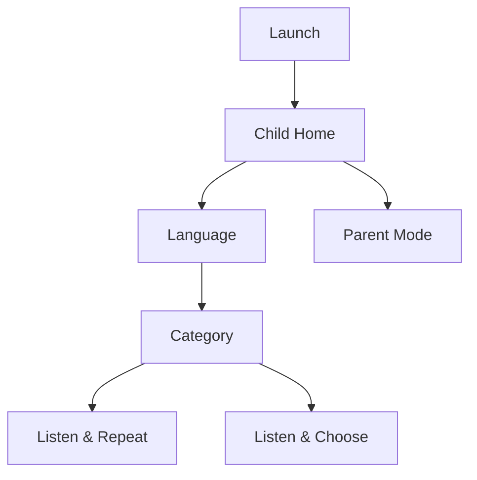

# Kids Language Companion UI / UX 设计书

> Version: 1.1 Draft Baseline  
> Target: Preschool child / Android tablet / 2560×1600 / 16:10  
> Primary Orientation: Landscape

---

# 1. 设计目标

这个 App 的 UX 不能按照“成人语言学习软件”设计。

儿童可能：

- 看不懂页面标题；
- 看不懂按钮文字；
- 不知道“提交”“继续”“重试”是什么意思；
- 不会读日语假名、汉字、英语单词；
- 会直接点击最显眼的东西；
- 在失败 2～3 次后迅速失去兴趣。

因此 Child Mode 必须做到：

> **即使把页面上的文字全部遮住，儿童仍然基本知道下一步该做什么。**

---

# 2. UX 原则

## UX-P01 Audio & Image First

信息优先级：

```text
图片 / 动画
> 声音
> 图标
> 文字
```

## UX-P02 One Primary Action

一个练习页只有一个最重要动作。

例如跟读页：

```text
Primary Action = 说话
```

不得同时出现 6 个同等级按钮。

## UX-P03 Large Touch Targets

儿童主要触摸目标：

- 推荐 88～120 dp；
- 关键主按钮可达 128～180 dp；
- 不采用成人常见的 40～48 dp 小 icon button 作为主要任务入口。

## UX-P04 No Punishment UI

禁止儿童模式中使用：

- 大红叉；
- “错误”；
- “0 分”；
- 失败蜂鸣；
- 倒计时压迫；
- 扣生命；
- 连败提示。

## UX-P05 Always Recoverable

孩子任何时候都应可以：

- 再听一次；
- 再试一次；
- 继续下一题。

## UX-P06 Predictable Layout

Speaker、Mic、Back 等按钮位置长期稳定，减少认知负担。

## UX-P07 Short Feedback Loop

一题从开始到完成建议 5～15 秒。

## 2.1 Mascot First Guidance

儿童模式引入固定主角色（白色小兔子）作为“引导者 + 反馈者”。

角色职责：

- 欢迎孩子开始练习；
- 在播放示范时做“认真听”的提示动作；
- 在孩子需要开口时做“请说话”的提示动作；
- 答对时做高兴庆祝动作；
- 未通过时做温和鼓励动作；
- 在首页与完成页增强陪伴感。

角色不是单纯装饰，应参与关键 UX 提示。

---


# 2.2 吉祥物视觉设定

V1 选定角色：**可爱白色小兔子**。

固定外观要素：

- 白色圆润毛发；
- 大眼睛、粉色腮红、亲和笑容；
- 蓝色连帽衫；
- 黄色/橙色小书包；
- 胡萝卜徽章；
- 整体为低龄儿童友好、明亮柔和的卡通风格。

角色状态与用途：

| 状态 | 用途 | 视觉说明 |
|---|---|---|
| Idle | 首页/待机 | 微笑挥手 |
| Listen | 系统播放示范 / 正在听 | 侧耳倾听，耳旁提示线 |
| Speak | 轮到孩子说 | 张嘴邀请、手势引导 |
| Great | 答对庆祝 | 跳跃、星星环绕 |
| TryAgain | 未通过重试 | 略沮丧但可爱，不制造压力 |
| Praise | 鼓励继续 | 眨眼或点赞 |

配套概念素材见：`assets/mascot/bunny_mascot_expression_sheet.png`。

# 2.3 反馈动画原则

- 成功反馈：放大 1.03~1.08 倍、上跳、星星粒子、愉快音效；
- 鼓励重试：轻微下沉、蓝色汗滴/小波纹、柔和“再试试”音效；
- 待机状态：轻微上下浮动，周期 2.5~4 秒；
- 倾听状态：耳朵和头部可轻微左右晃动；
- 动画不可持续过长，避免拖慢节奏；
- 角色与题目图片区应分区布局，防止遮挡。

# 3. 屏幕与尺寸策略

物理屏幕：

```text
2560 × 1600 px
16 : 10
10.8 inch
```

Compose 中不得按 2560×1600 px 直接写死。

设备实际 density 可能不同，因此：

- 布局使用 `dp`；
- 字体使用 `sp`；
- 图像使用比例和 constraints；
- 通过 `WindowMetrics` / 可用尺寸响应。

## 3.1 Reference Canvas

建议设计参考：

```text
1280 × 800 dp class
```

但所有页面必须能适应目标平板实际 `dp` 尺寸。

## 3.2 Safe Area

边缘至少保留：

```text
32 dp normal safe padding
48 dp preferred child interaction padding
```

---

# 4. 信息架构



实际实现中，Home 可以直接把 Language 作为第一层，不需要单独页面。

---

# 5. Child Home

## 5.1 目标

孩子打开 App 后只需要回答一个问题：

> “今天想玩哪一种语言？”

## 5.2 页面布局

```text
┌────────────────────────────────────────────────────────────┐
│                                                    👪      │
│                                                            │
│                   [ mascot / welcome ]                     │
│                                                            │
│     ┌─────────────┐ ┌─────────────┐ ┌─────────────┐        │
│     │             │ │             │ │             │        │
│     │   🇯🇵       │ │   🇨🇳       │ │   🇬🇧       │        │
│     │  scene art  │ │  scene art  │ │  scene art  │        │
│     │             │ │             │ │             │        │
│     └─────────────┘ └─────────────┘ └─────────────┘        │
│                                                            │
└────────────────────────────────────────────────────────────┘
```

### 不依赖文字的方法

点击卡片时播放短语音：

- 日本語 → 「にほんご！」
- 中文 → 「中文！」
- English → “English!”

文字名称可以显示，但不是必要信息。

## 5.3 卡片尺寸

每个语言卡：

- 约屏幕宽度 25～28%；
- 高度约 300～380 dp；
- 点击区域整卡有效。

---

# 6. Category 页面

## 6.1 日语建议分类

儿童页面使用图像，而不是抽象文字目录：

| Category | Main Visual |
|---|---|
| 幼儿园 | 幼儿园建筑 / 老师和孩子 |
| 一起玩 | 两个孩子玩玩具 |
| 吃饭 | 餐盘 |
| 厕所 | 厕所图标 |
| 身体 | 孩子指身体 |
| 回家 | 家 / 家长接送 |

## 6.2 Layout

横屏 2×3 大卡片：

```text
┌────────────┐ ┌────────────┐ ┌────────────┐
│   School   │ │    Play    │ │    Food    │
└────────────┘ └────────────┘ └────────────┘

┌────────────┐ ┌────────────┐ ┌────────────┐
│   Toilet   │ │    Body    │ │    Home    │
└────────────┘ └────────────┘ └────────────┘
```

每张卡点击时可以先播放该分类代表语音或短音效。

---

# 7. Listen & Repeat 页面

这是 V1 最核心页面。

## 7.1 Default Layout

```text
┌────────────────────────────────────────────────────────────┐
│ ←        ● ● ● ○ ○ ○                               🔊     │
│                                                            │
│                                                            │
│                    ┌────────────────┐                      │
│                    │                │                      │
│                    │   large image  │                      │
│                    │                │                      │
│                    └────────────────┘                      │
│                                                            │
│                 いっしょに あそぼう                         │  optional
│                                                            │
│                         🔊                                 │
│                                                            │
│                       ┌─────┐                              │
│                       │ 🎤  │                              │
│                       └─────┘                              │
│                                                            │
└────────────────────────────────────────────────────────────┘
```

## 7.2 Visual Hierarchy

1. Scene Image
2. Mic State / speaking cue
3. Speaker replay
4. Optional text
5. Progress
6. Back

## 7.3 Prompt Playback State

播放时：

- Speaker 图标做轻微声波动画；
- Mic 暂时 inactive；
- Scene character 可有轻微口型 / bounce。

## 7.4 Ready to Speak

Prompt 结束后：

- Mic 放大 5～10%；
- 出现柔和呼吸动画；
- 播放很短的“轮到你”提示音，可在设置关闭；
- 不显示文字说明“请朗读以下句子”。

## 7.5 Listening State

```text
Mic → animated ring
Voice energy → 3～5 bars / waveform
```

禁止展示复杂实时频谱。

## 7.6 Recognizing State

识别一般很短。

显示：

- mascot thinking animation；
- mic → small dots。

不得出现技术术语“Recognizing...”。

---

# 8. Success Feedback

## 8.1 Normal Pass

视觉：

```text
⭐ → ⭐⭐ → ⭐⭐⭐
mascot jump
short sparkle
```

声音：

```text
短、明亮、不刺耳成功音
```

持续约：

```text
800～1500 ms
```

然后自动下一题。

## 8.2 Soft Pass

儿童视角不应区分 Normal Pass 与 Soft Pass。

可以使用较温和但仍正面的反馈：

```text
👍 + mascot smile
```

但绝不显示：

```text
“勉强通过”
“60%”
```

家长统计中可以区分。

---

# 9. Retry Feedback

Retry 不是“失败画面”。

## 9.1 第一次未通过

流程：

```text
mascot: listening gesture
→ speaker 自动重播
→ mic 再次出现
```

可以播放：

```text
“もういっかい” / “再来一次” / “One more time!”
```

但语言提示最好与学习语言一致，且可关闭。

## 9.2 No Speech

如果儿童没有开口：

- Mic gently pulse；
- mascot 指向嘴巴；
- 不播放失败音。

---

# 10. Listen & Choose 页面

## 10.1 Layout

```text
┌────────────────────────────────────────────────────────────┐
│ ←        ● ● ○ ○ ○ ○                              🔊      │
│                                                            │
│                         🔊                                 │
│                                                            │
│       ┌────────────────┐   ┌────────────────┐              │
│       │                │   │                │              │
│       │    picture A   │   │    picture B   │              │
│       │                │   │                │              │
│       └────────────────┘   └────────────────┘              │
│                                                            │
│       ┌────────────────┐   ┌────────────────┐              │
│       │    picture C   │   │    picture D   │              │
│       └────────────────┘   └────────────────┘              │
│                                                            │
└────────────────────────────────────────────────────────────┘
```

对于初期难度，优先 2 个选项；熟悉后增加到 3 或 4。

## 10.2 Correct Choice

- card scale up 1.03～1.06；
- 柔和 glow；
- 星星反馈；
- 自动下一题。

## 10.3 Wrong Choice

错误卡片：

- 小幅左右摇动；
- 回到原状态；
- 自动重播音频。

不得变成大红色。

第二次错误后，可以给正确图片轻微边框呼吸提示。

---

# 11. Progress 表示

儿童不需要数字：

```text
3 / 10
```

优先用：

```text
● ● ● ○ ○ ○ ○ ○
```

或者一条角色走向目标的路径。

必须让儿童知道“这一轮快结束了”，避免无边界感。

---

# 12. Session Complete

完成一轮后：

```text
┌──────────────────────────────────────────────┐
│                                              │
│                🎉 mascot 🎉                 │
│                                              │
│                  ⭐⭐⭐                        │
│                                              │
│      [ big replay/new round button ]         │
│                                              │
│      [ home icon ]                           │
│                                              │
└──────────────────────────────────────────────┘
```

不需要成绩百分比。

可显示“今天收集的星星”，但 V1 不持久化为竞争型货币。

---

# 13. Parent Mode

## 13.1 Entry

Child Home 右上角小型家长图标。

进入方式：

```text
Long press 2～3 seconds
```

配合圆形进度 ring，防止误触。

V1 不要求 PIN。

如果实际儿童经常能误进入，再增加可选 PIN。

## 13.2 Parent Home

允许比 Child Mode 更文字化：

```text
Language
Practice settings
Text display
Session length
Audio
Progress
Diagnostics
About
```

## 13.3 Settings Controls

建议：

| Setting | Control |
|---|---|
| Default language | segmented / radio |
| Show text | switch |
| Auto play | switch |
| Auto record | switch |
| Auto next | switch |
| Session items | 5 / 10 / 15 |
| Sound effects | switch |

---

# 14. 颜色与视觉

V1 不规定具体品牌色，但必须遵守：

- 背景尽量简单；
- 一页主色数量有限；
- 练习主体图片对比明显；
- 成功可使用暖色 / 亮色；
- Retry 不用强红；
- Disabled 状态通过灰度 + 透明度 + 图标共同表达。

禁止只靠绿色 / 红色区分正确错误。

---

# 15. Typography

儿童模式文字是辅助，因此不应成为视觉中心。

建议：

| Type | Size range |
|---|---:|
| Optional target phrase | 32～48 sp |
| Category label | 24～32 sp |
| Parent title | 28～36 sp |
| Parent body | 18～24 sp |

实际值需根据目标设备 density 真机校准。

日语字体必须正确显示 Kana/Kanji；中文必须保证 CJK fallback。

---

# 16. 图像规范

好的学习图片应该：

- 一图表达一个主要动作或含义；
- 背景简单；
- 主体明显；
- 不需要读图中文字；
- 人物表情和动作易理解；
- 不依赖文化隐喻。

坏例子：

```text
“かして”
→ 只画一个玩具
```

好例子：

```text
一个孩子把手伸向另一个孩子手里的玩具
```

因为目标语义是“借给我”，而不是“玩具”。

---

# 17. 动画规范

## 17.1 Recommended

- scale 0.95 ↔ 1.05 breathing
- short bounce
- star particle
- simple character arm movement

## 17.2 Avoid

- 全屏快速闪烁
- 长时间粒子雨
- 大幅 camera shake
- 高频抖动
- > 2 s 且不可跳过的动画

## 17.3 Frame Budget

所有动画应避免大图实时复杂 blur。

目标：目标平板上保持稳定 60 Hz 感知流畅度。

---

# 18. Sound UX

声音分成三类：

```text
1. Learning prompt
2. UI cue
3. Reward effect
```

它们不得互相覆盖。

优先级：

```text
Learning prompt > recording > reward > background music
```

录音开始时：

- prompt 必须结束；
- background music pause/duck；
- reward 不可播放。

---

# 19. 可访问性与儿童安全

- 不要求阅读；
- 不只靠颜色；
- 音效可以关闭；
- 主要按钮有足够点击范围；
- 不做广告跳转；
- Child Mode 不提供浏览器链接；
- 不提供自由文字聊天；
- 不提供未知外部内容；
- 不显示复杂技术错误。

---

# 20. Empty / Error States

## Microphone Permission Denied

Child UI：

```text
🎤 with small lock
+ Listen & Choose large button
+ Parent icon
```

不要要求孩子阅读 Android 权限说明。

## ASR Model Error

Child UI：

```text
mascot + speaker mode
```

家长入口显示具体修复信息。

## Missing Content Asset

自动跳过该题，儿童不进入错误页面。

---

# 21. Orientation

V1 Child Mode 建议锁定 Landscape。

理由：

- 目标设备 16:10 平板；
- 横屏可同时放大图和大交互按钮；
- 减少开发与测试组合；
- 避免儿童转动平板造成练习中断。

Parent Mode 仍可保持同方向。

如果未来需要手机版本，再另行做响应式 Portrait 设计，不把 V1 复杂化。

---

# 22. 关键页面验收尺寸

以目标平板实际 dp 为准，但真机验收至少检查：

### Home

- 3 个语言卡片同时完整显示；
- 每个卡片整个区域可点；
- Parent icon 不会被语言卡遮挡。

### Repeat

- Scene image 高度至少占可用高度约 35%；
- Mic 是页面最醒目的交互目标之一；
- Speaker 与 Mic 不重叠；
- 长日语句子不把 Mic 推出屏幕。

### Choose

- 4 张卡片在 2×2 模式下均可显示；
- 卡片之间有足够间距避免误触；
- 正确反馈不改变布局导致卡片跳位。

---

# 23. 文案原则

儿童文案：

- 极短；
- 正面；
- 不评价人格或能力；
- 不强调错误。

推荐：

```text
もういっかい！
できた！
やった！
```

中文：

```text
再来一次！
真棒！
```

英语：

```text
One more time!
Great!
You did it!
```

不要：

```text
发音错误
Incorrect
不合格
```

---

# 24. Figma / Design Token 建议

未来进入视觉设计时，建议建立以下 token：

```text
spacing.1 = 8dp
spacing.2 = 16dp
spacing.3 = 24dp
spacing.4 = 32dp
spacing.5 = 48dp
spacing.6 = 64dp

radius.card = 28dp
radius.primary = 40dp

touch.minimum = 72dp
touch.childPrimary = 96dp
```

具体色值后续由视觉稿决定。

---

# 25. UI 实施顺序

建议：

```text
1. Home
2. Category
3. Listen & Choose
4. Repeat static screen
5. Recording state animation
6. Success / Retry
7. Parent Mode
8. Session complete
9. Visual polish
```

先验证 Child Flow，不要先做复杂家长统计页面。

---

# 26. UX 真机观察清单

开发者不要主动解释操作，观察孩子是否自然理解。

记录：

- 能否独立点击语言；
- 是否知道 Speaker 可以再听一次；
- Prompt 结束后是否知道轮到自己说；
- 是否会对着平板说话；
- Mic 动画是否足够明确；
- Success 动画是否能让孩子理解“成功了”；
- Retry 是否让孩子愿意再说一次；
- 选择图片时是否理解题意；
- 是否会误触 Back / Parent；
- 一轮多长开始疲劳。

这些观察结果应反向修改：

- 动画；
- 按钮大小；
- 等待时间；
- ASR 阈值；
- Session 长度；
- 图片语义。


---

# 附录：主要页面中的角色布局建议

## A. Home

- 左侧或中上区域显示 `Idle` 小兔子；
- 右侧/下方显示语言入口与开始按钮；
- 角色可作为主要视觉吸引点，但不得压缩入口按钮可点区域。

## B. Listen & Repeat

推荐区域分布：

```text
┌──────────────────────────────────────────┐
│  场景图片区              角色区(右侧)     │
│  [Image]                [Speak/Listen]   │
│                                          │
│  Speaker按钮      目标短句(可选)         │
│                                          │
│             大 Mic 按钮 / 波形            │
└──────────────────────────────────────────┘
```

- 播放示范时角色显示 `Listen`；
- 轮到孩子说时角色切换 `Speak`；
- 成功后可全屏中央短暂显示 `Great`；
- 多次失败后显示 `Praise` 或 `TryAgain`，继续下一题。

## C. Listen & Choose

- 角色可位于上方小尺寸角落，降低对图片选项的遮挡；
- 播放题目时显示 `Listen`；
- 选对后短暂切换 `Praise`。

## D. Result / Session Complete

- 主角色使用 `Great` 或 `Praise`；
- 可与星星、贴纸或“小小完成徽章”联合出现；
- 反馈文案保持极短，例如“太棒了！”“做得好！”。
