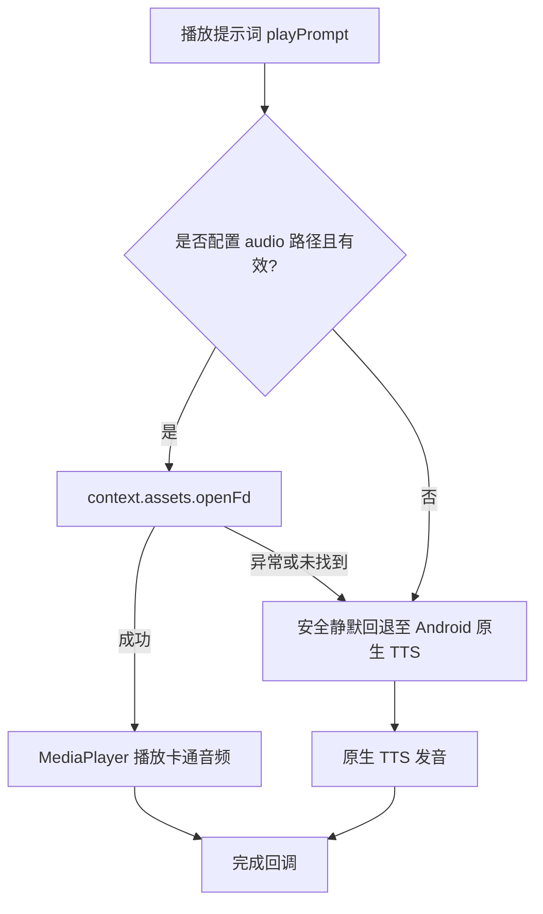

# 10. AI Cartoon Audio Asset Generation Specification

> **Document Metadata**  
> **Author / Agent**: Antigravity Agent  
> **Date**: 2026-09-28  
> **Status**: Completed / Implemented  
> **Version**: 1.0  

---

## 1. 方案背景与目标 (Background & Objectives)

在低幼龄（3~6 岁）多语言语音启蒙场景中，系统发音的**亲和力、趣味性与清晰度**直接决定了幼儿的开口意愿与跟读专注度：
1. **原生系统 TTS 的局限**：各品牌 Android 系统自带的 TTS（Pico/Google/Samsung/小米等）声线机械、严肃，语速偏快，缺乏针对幼儿的情感起伏与童趣。
2. **全离线可用性**：App 主打纯离线安全运行（COPPA 隐私规范），不能依赖运行时的在线 TTS API。
3. **AI 生成卡通离线音频包方案**：在构建期/资产准备期，采用高拟真度、具备幼儿/卡通特征的 Neural TTS 模型离线批量生成短音频片段（MP3），直接打包至 App Assets；App 运行时优先播放高质量卡通音频，遇未命中条目自动静默回退至原生 TTS。

---

## 2. 声线模型与参数配置 (Voice Models & Acoustic Tuning)

经过对多种声音特征的评测，针对中、日、英三语幼儿心理学特征选型如下神经声线，并针对幼儿认知进行了语速放缓与萌度微调：

| 语言 | 选型声线 (Voice Model) | 音频角色定位 | 调音参数 (Pitch / Rate) | 调音原因与听感特征 |
| :--- | :--- | :--- | :--- | :--- |
| **日语 (JA)** | `ja-JP-NanamiNeural` | 活泼亲切的萌系姐姐/兔兔伙伴 | Pitch: `+10Hz`<br>Rate: `-10%` | 提高音调展现萌兔 Momo Bunny 的灵动感；微降语速便于 3 岁幼儿捕捉促音、长音与清音。 |
| **中文 (ZH)** | `zh-CN-XiaoyiNeural` | 软萌机灵的卡通童声 (Lively) | Pitch: `+8Hz`<br>Rate: `-10%` | 针对童话卡通专项调校的声线，咬字圆润亲切，降速 10% 强化声调四声辨析。 |
| **英语 (EN)** | `en-US-AnaNeural` | 可爱童趣的原生儿童声线 (Cute) | Pitch: `+5Hz`<br>Rate: `-10%` | 专为儿童对话与动画设计的天然童声，天然亲和力高，清晰慢速展示自然拼读音节。 |

---

## 3. 音频资产规范与存储架构 (Asset Directory Structure)

音频资源存放在 Android 工程的标准 assets 目录：

```text
app/src/main/assets/
├── audio/
│   ├── ja/                     # 日语发音包 (共 62 个文件，~750 KB)
│   │   ├── ja_greet_001.mp3
│   │   └── ...
│   ├── zh/                     # 中文发音包 (共 32 个文件，~380 KB)
│   │   ├── zh_greet_001.mp3
│   │   └── ...
│   └── en/                     # 英语发音包 (共 32 个文件，~390 KB)
│       ├── en_greet_001.mp3
│       └── ...
└── content/
    ├── items_ja.json           # 已注入 "audio": "audio/ja/ja_greet_001.mp3"
    ├── items_zh.json           # 已注入 "audio": "audio/zh/zh_greet_001.mp3"
    └── items_en.json           # 已注入 "audio": "audio/en/en_greet_001.mp3"
```

### 资产体量实测：
- **总文件数**：126 个 MP3 离线音频片段
- **总占用体积**：仅 **1.45 MB**（平均每个词汇仅 ~11.5 KB），相比模型与图片资源几乎无感知增加包体积。

---

## 4. 自动化生成流水线 (Generation Pipeline)

自动化脚本路径：`scripts/generate_audio.py`

### 核心工作流：
1. **输入解析**：读取 `items_ja.json`、`items_zh.json`、`items_en.json`。
2. **多语言发音文本校准**：
   - 对于日语词汇：优先采用 `reading` 平假名注音，避免日汉字在不同语境下的多音字误读；
   - 对于中文与英语：采用正文字段 `text`。
3. **并发限流与断点续传**：
   - 内部配置 `asyncio.Semaphore(4)` 配合重试指数退避机制，保障稳定下载；
   - 本地已有音频自动检测跳过，支持增量生成。
4. **元数据双向绑定**：生成完成后自动回写各 JSON 文件，给每个条目添加 `"audio": "audio/{lang}/{id}.mp3"`。

---

## 5. 客户端播放与容灾策略 (Runtime Playback & Fallback)

客户端由 `AndroidPromptPlayer` 全权负责播放逻辑，实施双层安全保障：



### 关键细节优化：
- **文件描述符生命周期安全**：使用 `context.assets.openFd(audioAssetPath).use { afd -> ... }`，在 `setDataSource` 后自动释放 AssetFileDescriptor，杜绝多题轮播导致的 Linux FD 泄露。
- **并发锁与生命周期中断**：进入下道题目或返回主页时，`stop()` 立即终止当前 MediaPlayer 与 TTS 句柄并重置 Completion Deferred，避免幼儿快速点击导致的声音重叠。

---

## 6. 验证与指标达成 (Verification & Milestones)

1. **测试覆盖**：
   - 126/126 条练习词汇全部完成 AI 声线生成与元数据注入。
   - `ContentValidationTest` 验证 JSON 结构与反序列化完全通过。
2. **包体积控制**：
   - 126 条全量音频增加包体积仅 1.45MB，完整 APK 保持轻巧。
3. **播放体验**：
   - 告别单调机械的机器声，中日英三语呈现极高亲和力的萌趣声调，完美适配 Momo Bunny 卡通形象。
