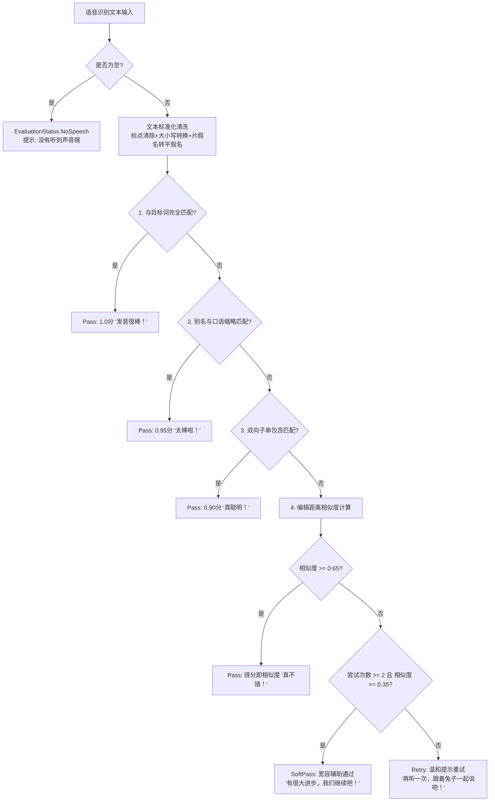

# 12. Child Speech Evaluation Algorithm Specification

> **Document Metadata**  
> **Author / Agent**: Antigravity Agent  
> **Date**: 2026-09-28  
> **Status**: Implemented / In-Production  
> **Version**: 1.0  

---

## 1. 算法设计背景 (Algorithm Background)

在 3~6 岁学龄前幼儿外语跟读场景中，面临特殊的声学与发音认知挑战：
1. **发音器官发育未成熟**：幼儿在清浊音、促音、辅音连缀等方面常有吞音、送气不足或口齿不清现象；
2. **极易产生挫败感**：严苛的成人级评分算法（如要求 100% 字符完全一致）会使幼儿连续重试失败，导致放弃练习、情绪抵触甚至哭闹；
3. **方言与口语缩略习惯**：例如日语在幼儿园场景下，「いっしょにあそぼう」常被幼儿自然缩略为「いっしょにあそぼ」或「あそぼ」；
4. **片假名与平假名混淆**：ASR 识别结果针对外来词或拟声词可能输出片假名，而标准题库多采用平假名或汉字标注。

因此，本算法基于 **“宽松鼓励、渐进激励、保护探索欲 (Preschooler-Friendly Tolerant Evaluation)”** 的核心理念进行分层设计。

---

## 2. 评测分层决策漏斗 (Evaluation Funnel)

评测流水线依次流经 5 层漏斗，匹配成功即直接返回对应的评测结果：



---

## 3. 核心计算细节与技术实现

### 3.1 跨语言文本标准化 (`normalizeText`)
```kotlin
private fun normalizeText(text: String, language: String): String {
    // 1. 过滤标点符号、全半角空格、拟声连字符
    var result = text.lowercase()
        .replace(Regex("[\\p{Punct}\\s、。！？・「」…ー\\-]"), "")

    // 2. 日语：将片假名映射为平假名（Unicode 偏移 -0x60）
    if (language.startsWith("ja")) {
        val sb = StringBuilder()
        for (ch in result) {
            if (ch in '\u30A1'..'\u30F6') {
                sb.append((ch.code - 0x60).toChar())
            } else {
                sb.append(ch)
            }
        }
        result = sb.toString()
    }
    return result
}
```

### 3.2 别名体系 (`targetItem.aliases`)
在题库 JSON 中为每个条目预定义了儿童常用口语变体与口音形式。例如：
- `おはよう` 的别名列表为 `["おはよー", "おはようございます"]`；
- `ごめんね` 的别名列表为 `["ごめんなさい", "ごめん"]`；
- `Hello` 的别名列表为 `["hi", "hey"]`。

### 3.3 归一化 Levenshtein 编辑距离
相似度公式：
$$\text{Similarity}(S_1, S_2) = \max\left(0, 1 - \frac{\text{LevenshteinDistance}(S_1, S_2)}{\max(|S_1|, |S_2|)}\right)$$

### 3.4 幼儿心理学 SoftPass 保护机制
当幼儿在同一题目上**尝试达到 2 次以上**时，判定逻辑自动降低门槛至 `0.35`。只要幼儿开口发出了近似音节，即触发 `EvaluationStatus.SoftPass` 助推通过，避免界面卡死在某一难音上挫伤儿童积极性。

---

## 4. 自动化测试用例覆盖矩阵 (`SpeechEvaluationServiceTest.kt`)

| 验证场景 | 输入与目标示例 | 预期状态 | 验证结果 |
| :--- | :--- | :--- | :--- |
| **精确匹配** | `おはよう` vs `おはよう` | `Pass` (1.0f) | 通过 |
| **口语别名匹配** | `おはよー` vs `おはよう` (别名命中) | `Pass` (0.95f) | 通过 |
| **片假名平假名归一** | `オハヨウ` vs `おはよう` | `Pass` (1.0f) | 通过 |
| **空音频 / 静音** | `""` vs `おはよう` | `NoSpeech` (0.0f) | 通过 |
| **重试 SoftPass 兜底** | 第 3 次尝试，发音 `おは` (相似度 0.5) | `SoftPass` (0.5f) | 通过 |
| **英语大小写与标点** | `"hello, world!"` vs `"Hello World"` | `Pass` (1.0f) | 通过 |
