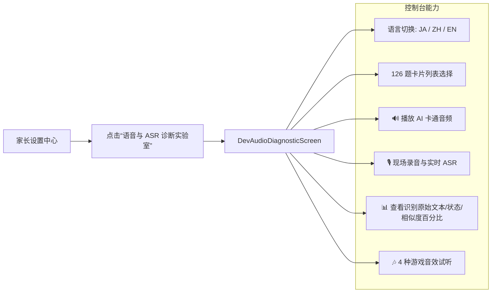

# 13. Sound Effects (SFX) & Diagnostic Lab Technical Specification

> **Document Metadata**  
> **Author / Agent**: Antigravity Agent  
> **Date**: 2026-09-28  
> **Status**: Implemented / In-Production  
> **Version**: 1.0  

---

## 1. 概述 (Overview)

为了让学龄前幼儿（3~6 岁）在跟读开口与点选答题过程中获得即时、生动且积极正向的游戏化反馈，同时为研发与家长提供现场诊断评测工具，实装了：
1. **轻量低延迟交互音效系统 (Sound Effect Manager)**：基于 Android `SoundPool` 的零延迟音效引擎与算法化音效生成管线；
2. **开发者与家长语音/ASR 诊断实验室 (Dev Audio Diagnostic Screen)**：提供中日英三语 126 题卡片试听、真机麦克风现场录音、Vosk 识别原始文本输出与 5 层算法评分的实时可视化控制台；
3. **学龄前权限容错引导 (Preschooler-Friendly Permission Fallback)**：麦克风未授权时弹出温和卡通弹窗，引导家长授权或自适应跳转至无需麦克风的选图模式。

---

## 2. 交互音效系统 (Sound Effect System)

### 2.1 声学特征设计与参数
针对低幼儿童听觉敏感、畏惧突兀尖锐噪音的心理学特征，音效应具备**柔和、饱满、非惩罚性**：

| 音效标识 | 音频文件 | 听感设计与合成参数 | 触发场景 |
| :--- | :--- | :--- | :--- |
| **Pop** | `pop.wav` | 400Hz $\to$ 1400Hz 快速上扫泡泡音，90ms 快速衰减 | 按钮点击、卡片点选、麦克风启停 |
| **Success** | `success.wav` | 大三和弦琶音 (C6 $\to$ E6 $\to$ G6 $\to$ C7)，550ms 泛音衰减 | 跟读通过、选图正确 |
| **Celebrate** | `celebrate.wav` | 欢庆大和弦华彩 (G5 $\to$ C6 $\to$ E6 $\to$ G6 $\to$ C7 $\to$ E7 闪烁泛音)，850ms | 练习轮次结算完成、大星星撒花 |
| **Retry** | `retry.wav` | 温和两音步木琴/马林巴音 (F5 $\to$ D5)，320ms 温暖衰减（无刺耳蜂鸣） | 跟读未通过、点选错误建议重试 |

### 2.2 播放技术架构 (`AndroidSoundEffectManager.kt`)
- **播放引擎**：Android 原生 `SoundPool`（最大 4 个并发流，音频属性 `USAGE_GAME` / `CONTENT_TYPE_SONIFICATION`）。
- **零延迟加载**：应用启动时通过 `openFd` 预加载至内存，避免 `MediaPlayer` 的解码开销与主线程卡顿。
- **状态联动**：订阅 `SettingsRepository.settingsFlow`，家长可在设置中一键静音所有音效。

---

## 3. 开发者与家长 ASR 诊断实验室 (`DevAudioDiagnosticScreen.kt`)

为了支持真机环境下快速排查 Vosk 语音识别与发音打分问题，在家长中心提供专属调试控制台：

### 核心能力指标：
1. **多语言全量覆盖**：即时切换 62 道日语题、32 道中文题、32 道英语题；
2. **实时评测反馈**：展示 Vosk 原始输出、5 级状态徽章（Pass / SoftPass / Retry / NoSpeech）、Levenshtein 相似度得分以及幼儿激励提示语；
3. **SoftPass 步长模拟**：可手动调节尝试次数（1次、2次、3次），直接观察高尝试次数下的防挫败阈值保护效果。

---

## 4. 麦克风权限友好容错 (Permission Handling)

在跟读界面中，当幼儿或测试设备未开启 `RECORD_AUDIO` 权限时：
1. 点击麦克风不再发生静默失败或闪退；
2. 弹出卡通主题提示对话框：“🐰 兔兔需要麦克风权限哦”；
3. 提供“去玩选图模式”快捷入口，支持一键切换至无需录音的趣味图片辨析玩法，确保使用流程不中断。
