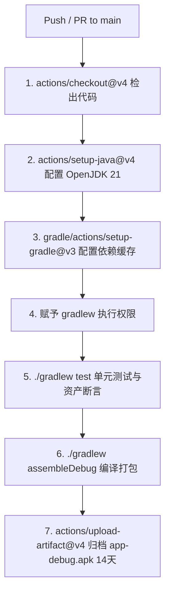

# 14. CI/CD & Offline Model Deployment Automation Specification

> **Document Metadata**  
> **Author / Agent**: Antigravity Agent  
> **Date**: 2026-09-28  
> **Status**: Implemented / In-Production  
> **Version**: 1.0  

---

## 1. 概述 (Overview)

为了保障《Kids Language Companion》代码库在多智能体协同开发、功能迭代与持续维护过程中的工程质量与交付效率，建立了双重自动化支撑体系：
1. **GitHub Actions CI/CD 云端质量门禁**：在代码提交与合并请求时，自动化执行环境初始化、单元测试、题库与音频资产完整性验证，并自动化打包产出 Debug APK 归档制品。
2. **Vosk 离线语音模型自动化部署管线**：提供全自动化下载、校验解压与真机 ADB 推送脚本，实现中日英小型声学模型从官方源到真机应用私有目录的一键部署。

---

## 2. GitHub Actions CI/CD 流水线 (`.github/workflows/android.yml`)

### 2.1 触发策略
- **Push 事件**：对 `main` 主干分支的每次代码推送；
- **Pull Request 事件**：针对 `main` 分支发起的合并请求。

### 2.2 工作流步骤编排


### 2.3 门禁防线
- **代码与模型编译通过性**：验证 Kotlin 2.0 编译器及 JNA Native 静态链接完整性；
- **题库与资产自动化断言**：执行 `ContentValidationTest`，严格保证 126 项题目 JSON Schema 合规、全量 126 个 MP3 卡通音频在包体内真实存在且非空、4 个低延迟 SFX 音效文件完整；
- **发音算法回归验证**：执行 `SpeechEvaluationServiceTest`，保障 5 层评测漏斗与 SoftPass 机制逻辑不产生退化。

---

## 3. Vosk 离线模型自动化部署 (`scripts/setup_vosk_models.py`)

### 3.1 目标模型与官方源
针对低幼龄 3~6 岁平板轻量化要求，选型以下经工业界充分验证的 Kaldi 小型模型：

| 语言 | 模型名称 | 压缩包体积 | 解压后体积 | 官方下载源 |
| :--- | :--- | :--- | :--- | :--- |
| **日语 (JA)** | `vosk-model-small-ja-0.22` | ~48 MB | ~95 MB | `https://alphacephei.com/vosk/models/vosk-model-small-ja-0.22.zip` |
| **中文 (ZH)** | `vosk-model-small-cn-0.22` | ~42 MB | ~85 MB | `https://alphacephei.com/vosk/models/vosk-model-small-cn-0.22.zip` |
| **英语 (EN)** | `vosk-model-small-en-us-0.15` | ~40 MB | ~80 MB | `https://alphacephei.com/vosk/models/vosk-model-small-en-us-0.15.zip` |

### 3.2 设备部署路径规范
设备内部/外部专有存储空间（无需敏感系统权限）：
```text
/sdcard/Android/data/com.kidslanguage.companion/files/models/
  ├── vosk-model-small-ja/
  ├── vosk-model-small-cn/
  └── vosk-model-small-en-us/
```

### 3.3 自动化脚本命令行参数
```bash
# 一键自动下载并推送到当前已连接的平板/模拟器
python scripts/setup_vosk_models.py

# 仅下载并解压到本地 models/ 缓存目录（不连接 ADB）
python scripts/setup_vosk_models.py --download-only

# 针对指定语言单独处理
python scripts/setup_vosk_models.py --lang ja
```

### 3.4 脚本容错特性
1. **断点校验**：本地若已存在完整压缩包或解压后目录，自动跳过重复下载，节约带宽与时间；
2. **设备智能探测**：调用 `adb devices` 自动识别在线设备，支持多设备指定 `--device <ID>`；
3. **安全容灾引导**：未检测到 ADB 设备时，打印格式化的手动 `adb push` 复制命令，方便运维人员手工部署。
