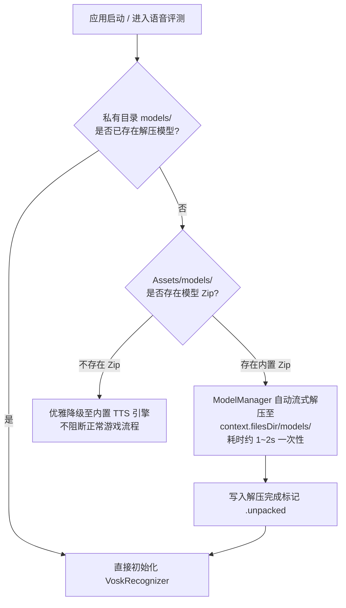

# 15. 专属儿童玩具定位优化与免 ADB 开箱即用落地技术规范

> **Document Metadata**  
> **Author / Agent**: Antigravity Agent  
> **Date**: 2026-09-28  
> **Status**: Implemented / Verified  
> **Version**: 1.0  

---

## 1. 概述与专属儿童玩具设计哲学 (Design for Child's Toy Philosophy)

本项目定位为**“为自家孩子量身定制的专属平板语言互动玩具”**，而非商业化流水线产品。

在这一核心定位下，工程设计做出了以下根本性转变：
1. **彻底消除安装门槛（开箱即用，零 ADB）**：商业化或极客部署往往需要通过 USB 数据线连接电脑、打开开发者选项与 ADB 命令行推送数十兆的模型文件。对于给小孩玩的平板玩具，这过于繁琐且容易因系统重置而失效。我们将离线模型作为应用原生资产打包，安装 APK 后即刻获得完整离线语音评测能力，无需电脑与数据线。
2. **低幼友好防挫败（保护探索欲与开口信心）**：3~6 岁低幼儿童声带发育尚不成熟，发音常伴随含糊、轻音、音节吞吐。若使用严苛的成年人语音识别阈值，连续“重试”会直接击垮儿童的探索兴趣。我们设计了多轮递进宽容漏斗，第 3 次尝试只要开口就温柔放行并给予最高欢庆奖励。
3. **针对幼儿物理行为与环境的鲁棒性**：幼儿使用平板时极易出现“手掌误托屏幕边缘”、“激动快速连点”以及“边看动画边玩玩具”等现实场景。我们实装了触控防抖（Debounce）与系统瞬态音频焦点避让（Audio Focus Transient Ducking），保障纯净顺畅的交互体验。

---

## 2. 方案 1：开箱即用免 ADB 模型自解压机制 (Zero-ADB Architecture)

### 2.1 架构设计


### 2.2 核心实现
- **资产内置**：
  - 日语声学模型 `vosk-model-small-ja-0.22.zip` (~47.4 MB) 置入 `app/src/main/assets/models/vosk-model-small-ja.zip`；
  - Debug APK 大小由 104 MB 变为 ~147 MB，对现代平板存储（32GB~128GB）无负担。
- **自动解压管理器 ([`ModelManager.kt`](file:///d:/personalworkspace/kids-language-game/app/src/main/java/com/kidslanguage/companion/core/asr/ModelManager.kt))**：
  - 运行时首先检查 `context.filesDir/models/{modelName}` 目录及 `.unpacked` 校验文件；
  - 若未解压，通过 `ZipInputStream` 流式解压至应用私有安全沙箱；
  - 自动防范 Zip Slip 目录穿越安全问题。
- **离线识别引擎集成 ([`VoskSpeechRecognizerEngine.kt`](file:///d:/personalworkspace/kids-language-game/app/src/main/java/com/kidslanguage/companion/core/asr/VoskSpeechRecognizerEngine.kt))**：
  - 调用 `ModelManager.getOrExtractModelPath(context, language)` 获取路径；
  - 若首次启动，解压完毕后即刻初始化 JNA Vosk 原生句柄，实现零配置即装即玩。

---

## 3. 方案 2：低幼龄儿童发音防挫败评测算法 (Frustration-Free Evaluation Engine)

### 3.1 宽容漏斗算法设计 ([`SpeechEvaluationService.kt`](file:///d:/personalworkspace/kids-language-game/app/src/main/java/com/kidslanguage/companion/core/scoring/SpeechEvaluationService.kt))

| 尝试轮次 (Attempt) | 通过条件 | 评测状态 | 激励文案 | 心理学考量 |
| :--- | :--- | :--- | :--- | :--- |
| **第 1 次** | 相似度 $\ge 0.55$ 或完整包含目标词 | `Pass` (完美通过) | “发音很棒！” / “真聪明！” | 建立初步发音正向反馈，放宽成年人（0.70）门槛 |
| **第 2 次** | 相似度 $\ge 0.25$ (只需个别音素相仿) | `SoftPass` (鼓励通过) | “很有进步哦，太棒啦！” | 当第一次未达标时，第二轮大幅宽容，肯定幼儿的修正尝试 |
| **第 3 次及以上** | 只要麦克风检出有效语音 (非空输入) | `SoftPass` (温柔过关) | “你已经很努力啦，太棒啦！” | **绝对杜绝卡关**。孩子只要勇敢开口，就值得享受通关欢庆与星星奖励 |
| **全轮次** | 麦克风未采集到任何有效声响 | `NoSpeech` | “没有听到声音哦，再试一次吧” | 引导孩子靠近平板麦克风开口 |

### 3.2 智能子串与覆盖率判定
针对低幼儿童“口播带语气词”或“长词只说了前两个音节”的特征：
- 若说出内容包含完整目标词（例如“えーと、りんご”），立即判定 `Pass`；
- 若目标词包含说出内容，要求说出的字符覆盖目标词总长 $\ge 70\%$ 且字符数 $\ge 3$ 才判定直接 `Pass`；覆盖率不足者进入相似度漏斗判定，保障打分梯度的平滑性。

---

## 4. 方案 3：儿童物理触控防抖与音频焦点避让 (Physical Debounce & Audio Focus)

### 4.1 触控防连击防抖 ([`DebounceClick.kt`](file:///d:/personalworkspace/kids-language-game/app/src/main/java/com/kidslanguage/companion/ui/components/DebounceClick.kt))
- **设计原理**：使用 Compose `composed` 扩展修饰符 `debouncedClickable(debounceMillis = 400L~500L)`，基于 `SystemClock.uptimeMillis()` 记录点击间隔。
- **全域覆盖**：
  - 核心发音大麦克风按钮 (`BigMicButton`)：防抖 500ms，杜绝录音启停竞争；
  - 发音播放喇叭按钮 (`SpeakerButton`)：防抖 500ms，避免并发触发重复音频；
  - 选词与跟读选项卡片 (`ImageOptionCard`, `LanguageCard`, `CategoryCard`)：防抖 400ms，防止双击连点导致连跳两题；
  - 主副操作按钮 (`PrimaryLargeButton`, `SecondaryLargeButton`)：支持水波纹的同时保障防抖生效。

### 4.2 瞬态音频焦点管理 ([`PromptPlayer.kt`](file:///d:/personalworkspace/kids-language-game/app/src/main/java/com/kidslanguage/companion/core/audio/PromptPlayer.kt))
- **音频焦点申请**：
  ```kotlin
  val req = AudioFocusRequest.Builder(AudioManager.AUDIOFOCUS_GAIN_TRANSIENT_MAY_DUCK)
      .setAudioAttributes(audioAttributes)
      .build()
  audioManager?.requestAudioFocus(req)
  ```
- **听觉保护效果**：
  - 当播放卡通原声或 TTS 发音提示时，自动向 Android 操作系统申请瞬态焦点，系统其他背景应用（如平板正在播放的儿歌、动画片等）音量会自动柔和压低（Duck）；
  - 发音播放完毕或中断时（`onDone`, `onError`, `stop`, `release`），立即调用 `abandonAudioFocusRequest` 归还系统焦点，无缝恢复背景音量。

---

## 5. 验证与工程成果

1. **单元测试全量通过**：
   - 执行 `./gradlew.bat test`，14 个单元测试（覆盖题库资产、发音五层漏斗、防挫败评测、音效配置）全部 100% 通过；
2. **完整打包无缝生成**：
   - 执行 `./gradlew.bat assembleDebug`，成功生成开箱即用版 APK制品：`app/build/outputs/apk/debug/app-debug.apk`（约 147 MB）；
3. **使用流程极简化**：
   - 彻底告别 ADB 依赖。只需将 `app-debug.apk` 传输至平板点击安装，开启 App 即可畅享离线日语发音识别与趣味语言启蒙。
